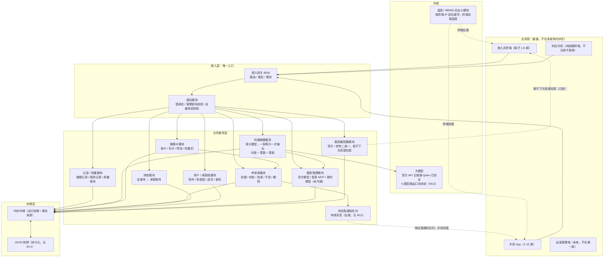
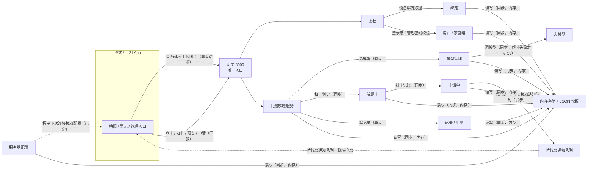
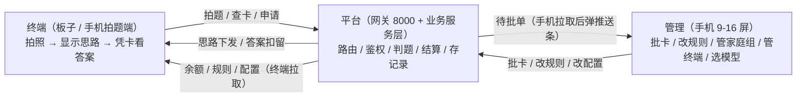

# 简题平台架构（2026-11-16）

- 文档性质：开发文档之一，只写架构，不写代码、不写接口文档（接口字段另有人写，见 §8 M13）。
- 依据（按权威从高到低）：板子原型 v113（`ban-zi-v113.html`）、手机原型 v155（`app-v155.html`）为准；`平台需求对齐-v113-v155.md`（2026-11-16）；`对齐缺口-20261116.md`（Nyx 核查，2026-11-16）；PRD v5.5（`jianti-prd-v5.5.docx`，2026-11-16，拉取／轮询纠正版，当前为准）。
- 规则：原型与 PRD 冲突时以原型为准；原型里没有的，不写成已经有了；未定的事逐条标“未定”，不悄悄定死。
- 代码骨架对照：任务给定时骨架路径 `~/workspace/jianti-alignment/platform-skeleton/` 不存在（2026-11-16 08:49 核查）；写作期间骨架分工落盘了 12 个 `.py` 文件＋`TESTLOG.md`＋`snapshot.json`，本文已按落盘内容逐项对照，见 §10。
- 现实前提（PRD v5.5 第 6 章，浩爷定）：服务端是升级加强，不是推倒重来——本地网关 8000 运行中，官方 API 主链路（Qwen）已验证，`/solve` 收图已跑通；终端／手机 App 是重做。升级顺序：先把已有链路（网关 8000、官方 API 主链路、`/solve` 收图）接进新版流程，再新增卡结算、申请单、绑定、记录沉淀。

## 0. 设计原则（四条，全文都按这四条落）

1. **服务端是唯一事实来源。** 原型是两个各自独立的本地演示（板子一份、手机一份，中间没有服务端），余额、申请单、卡规则、服务器选择、温度／MEMO、登录态在原型里各玩各的（见 §4.3 分叉收拢表）。第一版架构的第一件事就是收拢：所有共享状态只在服务端算、只在服务端存，终端只显示服务端返回的数，不自己算、不自己存账本。
2. **终端瘦。** 终端／App 只做拍照、发送、显示、管理入口；不做本地判题、不做本地大模型运算、不存卡账本。成本约束不变：小批量 150 元以内，万台 120 元以内；内存 16 兆、闪存 16 兆。
3. **失败有分支，没有只有成功链的流程。** 每个对外调用都写明超时、拒收、失败后终端停在哪一屏、给什么提示、怎么重发／重拍（见 §3.3、§6 C2）。
4. **不黑盒。** 接口、内部通信、外部通信的未定项全部登记在 §8，定好再开发；演示值（预支倍率、充值档位、预置题目、演示余额、家庭组 ID 12345678、演示手机号）只作走流程用的数，不作验收依据。

---

## 1. 系统分层

### 1.1 分层图



ASCII 版（与上图同一结构）：

```
应用层      嵌入式终端（板子）   手机 App（1-16 屏）   利旧手机（纯拍题终端）
                │                      │                      │
                └──────────┬───────────┴──────────────────────┘
                           ▼
接入层        接入网关 8000（唯一入口：路由 / 鉴权 / 限流）
                           │  鉴权模块（登录态 / 管理密码 / 设备绑定校验）
                           ▼
业务服务层    判题解题服务   解题卡   申请单   绑定   用户/家庭组
              模型管理   服务器配置   记录/用量   待拉取通知队列
                           │
                           ▼
存储层        内存存储（运行态唯一事实来源） ⇄ JSON 快照（持久化）
外部          大模型（官方 API Qwen 已验证）   温度/MEMO 后台小模块
```

### 1.2 每层是干什么的

| 层 | 包含 | 干什么 | 不干什么 |
|---|---|---|---|
| 应用层 | 嵌入式终端、手机 App、利旧手机、运营管理端（未来） | 拍照、显示、管理入口；拍完压到 8MB 以内发网关 `/solve`；官方地址 `solve.mhq-ai.xyz` 写死 | 不判题、不跑本地大模型、不存卡账本、不自己算余额 |
| 接入层 | 接入网关 8000、鉴权模块 | 平台层顶部唯一入口，只做路由、鉴权、限流；不是平台基础，不单独成层（PRD 6.1 纠正口径：8000 网关只是接入层入口）。鉴权：登录态校验、管理密码校验、设备绑定校验（设备号对上家庭账号才往下走） | 不做业务判断（不判题、不扣卡、不批申请）；不限流以外的业务限流 |
| 业务服务层 | 判题解题、解题卡、申请单、绑定、用户／家庭组、模型管理、服务器配置、记录／用量、待拉取通知队列 | 各模块只做一件事（见 §2）；模块之间只通过网关／内部调用通信，不直接读写对方的存储 | 不直接碰快照文件（只通过存储层）；不绕过网关直接对终端说话（配置与待拉取通知由终端拉取，见 §3） |
| 存储层 | 内存存储＋JSON 快照 | 运行态所有实体只在内存里算、只在内存里改；每次状态变更后写快照落盘；启动时从快照恢复（见 §4.1） | 不做跨服务数据库、不做实时同步到别的库（第一版没有别的库） |
| 外部 | 大模型、温度／MEMO 后台小模块 | 大模型一次输入一张照片，一次输出对错、思路、答案三样，不另建 CV／OCR，第一版只判最终结果；温度按终端 IP 定位城市后由终端拉取，未查到／未联网显示 `---°C`，不编数字；MEMO 由后台小模块管理、终端拉取，不能内置写死 | 大模型不直接对终端说话；温度／MEMO 模块不存业务数据 |
| 不在第一版 | 简题超智、专家私有模型、错题本完整版、WiFi 雷达、充值、错因线索与亲子沟通、家长推送复习包 | 见 §9。PRD 6.1 图 6-1 里“专家私有模型”是未来能力；“简题超智”在能力开放层最底部作智能底座——专家私有模型未建之前，闭环只走判题解题与数据服务两项，不宣称已具备 | — |

---

## 2. 模块清单（按任务给定布局，共 12 个模块）

| # | 模块 | 职责（一件事） | 归属层 | 依赖 | 自己的状态存在哪（见 §4） |
|---|---|---|---|---|---|
| 1 | 接入网关 8000 | 唯一入口：路由、鉴权、限流；查绑定（设备号对上家庭账号才往下走）；`/solve` 收图，上限 8MB（2026-11-08 由 2MB 改到 8MB，3.7MB 真图实测通过；板子压不到 2MB 也不拒收） | 接入层 | 鉴权、绑定 | 无业务状态；只记限流计数与请求日志（内存） |
| 2 | 鉴权 | 登录态校验（token／会话）；管理密码校验（6 位数字，注册时设、存服务端、与账号绑定；进管理输一次，管理内不再重复输，批申请不再输密码）；设备绑定校验 | 接入层 | 用户／家庭组、绑定 | 会话表（内存＋快照）；密码凭证随账号存，不单独建表 |
| 3 | 判题解题服务 | 调大模型：一张照片一次输出对错＋思路＋答案；把模型返回解析、拆题、重组成一题一页；思路先下发，答案扣在服务端 | 业务服务层 | 模型管理、解题卡、记录／用量 | 题目／批次（内存＋快照）；答案在服务端扣留，未解锁不下发 |
| 4 | 解题卡 | 查卡／扣卡／预支／防重扣；余额服务端强制校验，不为负；多端并发以服务端实时结算为准；每日张数最大 9、倍率最大 3（点确认才生效）；预支每次 1 张、不限次数、每笔留痕，上限＝每日张数×倍率，总可用＝每日张数×（1＋倍率） | 业务服务层 | 用户／家庭组、申请单、记录／用量 | 卡账本＋卡流水（内存＋快照），见 §4.2 |
| 5 | 申请单 | 申请单全生命周期：创建／待批／批准／不批／撤回，服务端统一管；申请一次是一次，不累计次数；取消＝撤回，家长端不得再批；只关弹窗不撤回；家长不批也不堵作业 | 业务服务层 | 解题卡、待拉取通知队列、用户／家庭组 | 申请单表（内存＋快照），见 §4.2 |
| 6 | 绑定 | 绑定关系：设备号 ↔ 家庭账号，一对一；扫码绑定、输入设备号绑定、解绑（先弹“确认解绑？”，确认该行消失）；利旧手机纯拍题终端也走本模块 | 业务服务层 | 用户／家庭组 | 绑定表（内存＋快照），主键设备 ID，见 §4.2、§6 L1/C1 |
| 7 | 用户／家庭组 | 账号（手机号＋登录密码）、家庭组、成员、角色（管理员／成员／待审批）、管理密码、邀请码（6 位）、转让／删除／通过／拒绝 | 业务服务层 | —（被鉴权、绑定、解题卡、申请单依赖） | 账号表、家庭组表、成员表（内存＋快照），见 §4.2 |
| 8 | 模型管理 | 三条线：官方模型（5 个，JT Lite 2.0 默认）、登录 MCP、我的模型（暂未开通、无入口、点不了）；先点行选中（圆点填黑、不跳），再点行尾“进入”进二次页；二次页选择不回改主行；只有被选中的那一行才是启动服务的那一项 | 业务服务层 | 判题解题服务 | 模型配置表（内存＋快照）；MCP 凭证不存、不建库，只留服务端内存临时验证码状态，用完即丢（M18 已定口径）；我的模型无记录（见 §6 L2） |
| 9 | 服务器配置 | 官方／自有二选一、互斥，默认官方，选中即保存；官方地址 `solve.mhq-ai.xyz` 写死不显示；自有在手机第 16 屏弹窗手填 IP，确认才生效；服务器配置在手机上改、板子下次连接拉取 | 业务服务层 | 绑定、网关 | 服务器配置表（内存＋快照），主键家庭组 ID，见 §4.2 |
| 10 | 记录／用量 | 每道题留原页图片、判题结果（只判最终结果）、思路／答案是否已解锁、用卡／预支／申请／跳过记录；第 13 屏只留三组数（拍题成功次、做题思路道、解题用卡张），点“详情”跳单独日志页（日期时间补零、各列对齐、来源写终端／成员、数量放最后，与时间筛选挂钩）；用量查询读服务端实数 | 业务服务层 | 判题解题、解题卡、申请单 | 题目记录表、日志明细表、用量表（内存＋快照），见 §4.2 |
| 11 | 待拉取通知队列 | 申请消息推送条：孩子发申请后，手机任何一屏顶部弹推送条；点主体跳第 13 屏，点条上“批准”当场批完；点 × 只关条不撤回；在第 13 屏时不弹条 | 业务服务层（基础设施） | 申请单 | 待拉取通知记录（内存，可不落快照——拉不到不补发，家长在第 13 屏仍能看到待批单）；**已定不建推送通道（M13）：本模块第一版是 stub：只定义“申请单状态变 → 写待拉取通知队列”这一个调用点，供终端拉取，不自选通道** |
| 12 | 内存存储＋JSON 快照 | 所有实体的运行态存储与持久化（见 §4.1）；各模块不直接读写快照文件，只调存储层 | 存储层 | —（被所有业务模块依赖） | 快照文件（见 §4.1 文件清单） |

**模块划分边界说明：** 解题卡（余额与规则）与申请单（审批流）是两个模块，但共用卡账本——批卡时申请单模块调解题卡模块记账，不自己改余额。用户／家庭组管“人”，绑定管“设备 ↔ 人”，两者不合并：设备可以换家庭组（解绑再绑），人也可以换设备，关系变化只写绑定表。模型管理只做选择与配置，不直接判题；判题解题服务只管调模型与重组，不决定用哪个模型（问模型管理）。

---

## 3. 模块间通信

### 3.1 调用关系图



**通信总规则：**

- 终端／App 只跟网关 8000 说话，不直连任何业务模块，不直连大模型，不直连存储层。下行只有一条路——拉取：待拉取通知队列 与服务器配置都不建推送通道（M13 已定，见 §8.2），终端侧一律按“下次连接时向服务端拉取最新状态”（即终端每次查卡／进管理时顺带拉一次申请单状态与服务器配置），不假设推送一定到达。
- 业务模块之间只通过内部调用通信，不经过网关（网关只对终端）。内部调用一律是内存内同步调用（同一进程内），失败即返回错误，不重试、不排队——重试只发生在终端 → 网关这一侧（见 §3.3），且重试必须带幂等键。
- 存储层调用是同步内存读写；快照落盘是每次状态变更后的同步写（先写临时文件再原子改名，见 §4.1），不走异步队列——卡账本与申请单状态不允许“内存已改、盘上没有”的窗口。

### 3.2 同步还是异步（逐调用）

| 调用 | 发起 → 接收 | 同步／异步 | 为什么这样定 |
|---|---|---|---|
| 拍题上传 `/solve` | 终端 → 网关 → 判题解题服务 | 同步请求；处理五阶段进度终端轮询 | 终端要等思路下发才进第 5 屏；五阶段（上传→网关→大模型→NLP→下发）是进度展示，靠终端轮询查进度（1 秒一次、最多 60 秒，超时 50401），不建推送通道（M13 已定）。原型里五阶段是按固定时间依次点亮的模拟（板子 `SEND_DURATIONS [500,500,1100,600,500]`），不代表真实进度 |
| 查卡／扣卡 | 终端 → 网关 → 解题卡 | **同步，强一致** | 余额以服务端为准；扣卡成功才显示过程／答案；多端并发以服务端实时结算为准。异步扣卡会在两端同时点卡时多扣或少扣 |
| 预支 | 终端 → 网关 → 解题卡 | 同步 | 预支每次 1 张、到上限停、余额不许成负数——上限判断必须在服务端当时算，不能事后对账 |
| 发申请单 | 终端 → 网关 → 申请单 | 同步创建；审批异步 | 创建要当场给发送成功／失败提示（见 §6 C2）；审批是家长稍后在手机上做的事，天然异步 |
| 批申请（点条上“批准”／第 13 屏点对号） | 手机 → 网关 → 申请单 → 解题卡记账 | 同步（批＋记账在同一次服务端操作内完成） | 批了的卡必须当场记到家庭账号；批与记账分开做会出现“已批未到账” |
| 推送申请消息条 | 申请单 → 待拉取通知队列 → 手机拉取 | 异步（拉取） | 推送是通知，不是审批本身；手机拉不到待拉取通知，家长在第 13 屏仍能看到待批单（拉取失败不阻塞申请单状态机） |
| 服务器配置下发 | 手机改 → 服务端保存；板子下次连接拉取 | 保存同步；拉取（已定，M13）：不建推送通道，板子下次连接／查卡时拉取 | 保存必须当场生效（手机上显示已选）；板子侧下次连接拉取最新配置 |
| 记录上传／写记录 | 判题解题／解题卡／申请单 → 记录／用量 | 异步（服务端内部写记录；终端不等待记录写完才进下一屏） | 记录是事后沉淀，不能拖慢拍题与扣卡主链路；但记录缺失的功能不计为完成（PRD 第 8 章验收） |
| 温度／MEMO 拉取 | 终端拉取（启动／联网时） | 终端启动／联网时拉取（同步拉取，失败显示 `---°C`） | 温度按终端 IP 定位城市后由终端拉取，未查到／未联网显示 `---°C`，不编数字；MEMO 由后台小模块管理、终端拉取 |
| 登录／注册／管理密码／绑定 | 手机／终端 → 网关 → 用户／家庭组／绑定 | 同步 | 登录、注册、绑定、管理一律走中心服务器；当场要给成功／失败结果 |
| 模型选择 | 手机第 16 屏 → 网关 → 模型管理 | 同步保存 | 选中即保存；只有被选中的那一行才是启动服务的那一项 |

### 3.3 失败了怎么办（总规则＋逐调用）

**总规则：**

1. 失败不静默：任何一次调用失败，终端必须停在有定义的屏、给一句话提示，不许卡在无按钮的中间屏、不许假装成功。
2. 扣卡类操作失败 = 没扣：网关超时、服务端报错、断网，终端都按“本次没扣卡”处理，不进结果页；重试必须带幂等键（批次 ID＋题号），服务端按幂等键去重，同一批同一题只扣一次。
3. 离开处理页取消未决步骤：终端离开第 4 屏处理页，未完成的上传／判题即取消，不留后台任务。
4. 网关是唯一入口，网关本身不可用时终端统一回第 7 屏设置页（PRD 口径：网络不通／拍题无反应跳设置页），不在各屏各写一套断网处理。

**逐调用失败表：**

| 调用失败 | 终端停在哪 | 给什么提示／走什么分支 | 重试／恢复 |
|---|---|---|---|
| `/solve` 上传超时／网关拒收（未绑定、鉴权失败、图片超 8MB） | 回第 7 屏设置页（未绑定／鉴权失败）或回第 3 屏取景器（图片问题／超时） | 未绑定：提示去绑定；超 8MB：提示重拍（图片已压到 8MB 以内仍超限属异常，记日志）；超时：提示网络问题 | 取景器重拍；绑定后重走 F1；不扣卡、不留“判题成功”记录 |
| 大模型调用失败／超时 | 第 4 屏处理页停在失败的阶段（见 §6 C2） | 显示该步失败，可回取景器重拍 | 重拍路径，不进思路页，不扣卡，记一条识别失败记录 |
| 模型没读出题（无题／空白／无法识别） | 第 4 屏处理页 → 回第 3 屏取景器 | 提示没拍到题／识别失败，可重拍 | 重拍；空白题不直达答案（F1 验收红线） |
| 查卡／扣卡超时 | 停在第 5 屏思路页，不进第 6 屏 | 提示查卡失败，请重试 | 点解题卡重试（带幂等键）；服务端没收到扣卡请求 = 没扣 |
| 扣卡时服务端返回无卡 | 转第 8 屏领取页 | 领取页给预支／申请两个入口 | 预支或申请，不硬堵 |
| 预支到上限／余额将为负 | 停在第 8 屏领取页 | 提示已到预支上限 | 不可再预支；走申请单 |
| 发申请失败（网关拒收／超时／断网） | 停在第 8 屏领取页（见 §6 C2） | 显示发送失败＋“重新发送” | 重发用同一申请单幂等键，不重复建单；成功才显示“申请已发送。”与撤回按钮 |
| 审批提交失败 | 停在第 13 屏，申请单仍为待批 | 提示审批失败，请重试 | 重试审批；不重复记账（记账与审批同一次操作，见 §3.2） |
| 手机拉不到待拉取通知 | 无感知——家长在第 13 屏仍能看到待批单 | 不提示（待拉取通知只是提醒） | 家长进第 13 屏即看到；不补发 |
| 服务器配置拉取失败 | 板子继续用上次生效的配置，并在第 7 屏显示配置未更新 | 不阻塞拍题 | 板子下次连接再拉取 |
| 记录上传失败 | 不阻塞当前流程；记录模块本地暂存后重试 | 不向学生提示 | 服务端按记录 ID 去重；重试直到成功，缺失不计为完成 |
| 连通测试某步不通 | 停在那一步，打叉变红 | 按真实网络结果显示，不编通过 | 整改网络后可重测；板子第 3 步测的是从服务端拉取的当前服务器配置（见 §7 板子连通第 3 步），未拉取到配置时第 3 步显示未测，不许恒通过 |

---

## 4. 数据存在哪

### 4.1 存储形态：内存存储＋JSON 快照

- **运行态唯一事实来源是内存。** 所有实体以内存结构（按主键索引的 map）持有；一切读（查卡、查申请单、查绑定、查配置）都读内存，不读盘。
- **持久化是 JSON 快照。** 每个实体一张快照文件，放在服务端数据目录下（目录名与落盘路径由骨架分工定，本文不定——只定文件清单与格式规则）。启动时按清单顺序加载快照恢复内存；快照损坏 → 启动失败并告警，**不自动丢数据重建**，等人工处理。
- **写策略：每次状态变更后同步写快照。** 写快照 = 先写同目录临时文件，写完再原子改名覆盖原文件；不许直接覆盖写一半。卡账本、申请单、绑定三类状态的写快照与内存改动在同一次服务端操作内完成，不留“内存已改、盘上没有”的窗口。
- **并发：服务端单写者串行化。** 同一家庭组的所有写操作（扣卡、预支、批卡、改规则）排队串行执行；不同家庭组之间不互斥。读不加锁。v2（服务器端 2026-11-17）：幂等预检与执行业务同锁内原子完成——`/solve` 查幂等→建 job→写记录整段进 `store.lock`，判题线程锁内起，同键并发只建一个 job；扣卡／预支／建单／审批／不批五口同理（见服务器端 v2 `TESTLOG.md` §6，待 dsh 复测）。
- **快照不是数据库选型。** 第一版按任务给定布局用内存＋JSON 快照；以后量大了要不要换数据库，是另行决策的事，本文不定。

**快照文件清单（每实体一个文件，文件名即实体名）：**

| 快照文件 | 对应实体 | 主键 |
|---|---|---|
| `accounts.json` | 账号 | 手机号（11 位） |
| `family_groups.json` | 家庭组 | 家庭组 ID（8 位纯数字） |
| `members.json` | 成员 | （家庭组 ID，成员编号） |
| `devices.json` | 设备（终端） | 设备 ID（16 位纯数字） |
| `bindings.json` | 绑定关系 | 设备 ID（另对家庭组 ID 建唯一索引：一台设备同一时间只绑一个家庭组） |
| `card_ledgers.json` | 卡账本（每家庭组每天一条） | （家庭组 ID，日期） |
| `card_transactions.json` | 卡流水（扣卡／预支／批卡每笔一条） | 流水 ID（服务端生成）；另以（批次 ID，题号）作幂等键去重 |
| `applications.json` | 申请单 | 申请单 ID（服务端生成，格式随 M13 接口定） |
| `solve_sessions.json` | 题目／批次（一次拍题一批） | 批次 ID（服务端生成）；题内序号 1…N |
| `usage_records.json` | 使用记录明细（日志页一行一条） | 记录 ID（服务端生成） |
| `usage_stats.json` | 使用记录三组数（拍题成功次／做题思路道／解题用卡张，按家庭组汇总） | 家庭组 ID |
| `server_configs.json` | 服务器配置 | 家庭组 ID |
| `model_configs.json` | 模型配置 | 家庭组 ID |
| `sessions.json` | 登录会话 | 会话 token |
| `weather_memo.json` | 温度／MEMO 下发值 | 设备 ID（温度）／全局＋家庭组（MEMO） |
| `push_deliveries.json` | 待拉取通知投递记录（可不落盘） | 推送 ID |

### 4.2 每个实体存在哪、主键是什么

| 实体 | 存在哪 | 主键 | 关键字段（只列架构必须有的，不列界面文案） | 谁写／谁读 |
|---|---|---|---|---|
| 账号 | `accounts.json` | 手机号（11 位，直接连写无空格） | 登录密码凭证、管理密码凭证（6 位数字，存服务端、与账号绑定；禁止明文落盘，具体哈希口径未定，等技术方书面确认——与 M14 同类口径）、角色、家庭组 ID | 写：用户／家庭组；读：鉴权 |
| 家庭组 | `family_groups.json` | 家庭组 ID（8 位纯数字，服务端生成、终身不变） | 成员列表、建立方式（已定：注册建虚拟组，见 §8.4） | 写：用户／家庭组；读：全部模块 |
| 成员 | `members.json` | （家庭组 ID，成员编号）；编号跟人走，转让不换号，新成员顺延 | 手机号（14 屏每行有一列手机号，如成员 1 `13800138000`、成员 2 `13900138001`、成员 3 `13500138004`；成员 1 的号与 12 屏账号条是同一个）、角色（管理员／成员／待审批，统一 3 字宽）、类型（苹果／安卓，2 字宽） | 写：用户／家庭组；读：绑定、记录 |
| 设备（终端） | `devices.json` | 设备 ID（16 位纯数字＝类型码 1 位＋15 位设备号；类型码 1 嵌入式、2 安卓、3 苹果、4 鸿蒙，0 其他／未知，5–9 预留） | 类型码、二维码载荷、Soft AP 热点名、版本号、服务器配置版本 | 写：绑定；读：网关（查绑定）、服务器配置 |
| 绑定关系 | `bindings.json` | 设备 ID；另对家庭组 ID 建索引 | 家庭组 ID、成员归属、绑定时间、绑定方式（扫码／输入设备号） | 写：绑定；读：鉴权、判题链路 |
| 卡账本 | `card_ledgers.json` | （家庭组 ID，日期） | 每日张数（默认 5，最大 9）、预支倍率（最大 3，默认 0）、今日已用、今日已预支、今日剩余（＝每日张数－今日已用，服务端算，终端只显示） | 写：解题卡；读：终端查卡、领取页、管理页 |
| 卡流水 | `card_transactions.json` | 流水 ID；（批次 ID，题号）为幂等键 | 类型（扣卡／预支／批卡／发卡）、数量、批次 ID、题号、操作来源（终端／成员）、时间 | 写：解题卡、申请单（批卡记账）；读：记录／用量 |
| 申请单 | `applications.json` | 申请单 ID（服务端生成） | 家庭组 ID、发起设备 ID、状态（待批／已批／不批／已撤回）、申请方式（按张／按倍由家长批时定）、数量、创建时间、审批时间、审批人 | 写：申请单；读：领取页（撤回按钮状态）、第 13 屏、待拉取通知队列 |
| 题目／批次 | `solve_sessions.json` | 批次 ID；题内序号 | 原页图片引用、每题判题结果（只判最终结果）、思路、答案（扣留标志：未解锁不下发）、解锁状态（未解锁／已解锁）、跳过标志 | 写：判题解题、解题卡（解锁）；读：终端思路页／结果页 |
| 使用记录明细 | `usage_records.json` | 记录 ID | 日期、时间（补零）、来源（终端 N／成员 N）、说明（一句小话）、数量（放最后）；与时间筛选挂钩（7 日内／30 日内／3 个月内）；筛选联动：9 天前一条只在 30 日内起显示、45 天前一条只在 3 个月内显示（原型演示记录的联动规则，服务端按真实记录实现） | 写：记录／用量；读：第 13 屏详情日志页 |
| 使用记录三组数 | `usage_stats.json` | 家庭组 ID | 拍题成功（次）、做题思路（道）、解题用卡（张）；预支、申请不列 | 写：记录／用量；读：第 13 屏 |
| 服务器配置 | `server_configs.json` | 家庭组 ID | 官方／自有（二选一互斥，默认官方）、自有 IP（手机第 16 屏弹窗手填，确认才生效）、配置版本号 | 写：服务器配置；读：网关、板子（下次连接拉取） |
| 模型配置 | `model_configs.json` | 家庭组 ID | 当前选中线（官方模型／登录 MCP／我的模型）、官方模型 5 选 1（JT Lite 2.0 默认）、MCP 临时验证码状态（内存，用完即丢，不落盘）；我的模型：无记录（未开通，见 §6 L2） | 写：模型管理；读：判题解题服务 |
| 登录会话 | `sessions.json` | 会话 token | 账号（手机号）、登录时间、过期时间 | 写：鉴权；读：鉴权 |
| 温度／MEMO | `weather_memo.json` | 设备 ID／家庭组 ID | 温度（按终端 IP 定位城市后下发，未查到显示 `---°C`）、MEMO（一句话，后台小模块维护） | 写：温度／MEMO 后台小模块；读：锁屏第 1 屏 |
| 用量 | `usage_records.json` 派生，不另建账本 | — | 每模型调用次数与费用（读服务端计量实数；原型 `usageData` 写死的 7 日／30 日／90 日三档演示数不得作为验收依据，见 §7 C3） | 写：记录／用量（接模型调用计量）；读：第 16 屏用量查询 |

**不建的表（明确不写，免得骨架分工误建）：** 充值表（充值系统已停，不做，档位与单价不设 M9）；MCP 账号密码库（凭证不存、不建库，M18 已定）；我的模型 Key 库（未开通，Key 存哪未定，见 §6 L2）；错因线索／亲子沟通表、错题本表、专家私有模型表（附录 A 未做，见 §9）。

### 4.3 三端分叉收拢：原型里各玩各的，服务端怎么收拢

对照缺口文档第三部分的三端分叉表。原型是两个各自独立的本地演示，板子一份、手机一份，中间没有服务端；下表每行写清：原型分叉现状 → 服务端唯一事实来源 → 三端怎么拿到同一份数。

| 状态 | 原型分叉现状（缺口文档 §三） | 服务端唯一事实来源 | 三端怎么共享同一份数据 |
|---|---|---|---|
| 解题卡余额 | 板子自己的 `cardBalance = 5`（v113:1166）；手机自己的 `cardBalance = 5`（v155:1748）。板子上用掉 1 张，手机余额不变，反过来也一样 | 卡账本 `card_ledgers.json`，主键（家庭组 ID，日期）；余额服务端算，网关强制校验，不为负 | 终端／手机每次显示余额前都问服务端（点解题卡先查卡、进 home／领取页时查卡）；终端不自己维护余额变量；多端并发以服务端实时结算为准 |
| 申请单 | 板子自己的 `askPending`（v113:1780）；手机自己的 `askPending`（v155:2075）。板子上发的申请，手机 13 屏看不到（仍是“暂无申请”）；反过来也一样 | 申请单表 `applications.json`，服务端统一管创建／待批／批准／不批／撤回 | 申请单一创建即写服务端；手机 13 屏读服务端待批单；领取页撤回按钮状态读服务端；待拉取通知队列 只作提醒，不作状态通道（拉不到通知，13 屏仍能看到） |
| 每日张数／倍率 | 板子写死 `ADVANCE_LIMIT = 5`（v113:1780）；手机 `dailyTotal`／`advanceRatio`，13 屏改完只改手机（v155:1749–1750）。手机上改了每日张数，板子今日剩余不变 | 卡账本（家庭组 ID，日期）里的每日张数与倍率；家长在第 13 屏点确认才保存生效，每日张数最大 9、倍率最大 3 | 改完即写服务端；板子下次查卡时拿新规则重算今日剩余（＝新张数－今日已用）；终端不缓存旧规则 |
| 服务器选择 | 板子没有 `serverMode` 变量，`selectSrv` 只换 CSS class（v113:1666–1675）；手机有 `serverMode = 'pub'`（v155:2008），只存本地。板子选了什么连自己都没存；手机选了也不下推到板子 | 服务器配置表 `server_configs.json`，主键家庭组 ID；官方／自有二选一，默认官方 | 手机改完写服务端；板子下次连接时拉取最新配置（已定：拉取，见 §3.2）；板子第 7 屏显示的服务器选择读服务端拉取的配置，不读本地 CSS 状态 |
| 温度／MEMO | 两边固定 `---°C`＋同一句 MEMO，没有下推，两边写死同一份演示值 | `weather_memo.json`；温度按终端 IP 定位城市后由终端拉取，未查到显示 `---°C`；MEMO 由后台小模块管理、终端拉取 | 终端启动／联网时向服务端拉取；两端显示同一份服务端值；MEMO 维护人／推送节奏未定（M13 清单内，见 §8） |
| 登录态 | 手机 `loggedIn` 只在手机内；板子没有账号概念 | 会话表 `sessions.json`（手机端登录态）；板子无账号，凭设备绑定鉴权 | 登录态只在手机端存在；板子不登录、不存会话，网关凭设备 ID 查绑定表放行；利旧手机作纯拍题终端同样不注册不登录，凭绑定鉴权 |

**收拢后的验收口径（纠正对齐文档 T1 的写法）：** 对齐文档 T1 写“三端转起来 对齐”是不准的——原型能证明的是两端各自的界面走通了，证明不了三端转起来。本架构里这条写成“**待服务端接通后联调验证**”：板子用 1 张卡后手机余额同步变、板子发申请后手机 13 屏出现待批单、手机改每日张数后板子今日剩余同步变，三项联调通过才算三端转起来，缺一不可。

---

## 5. 三端怎么转起来（终端 → 平台 → 管理 → 终端）

### 5.1 完整转圈



- **本地闭环（不出终端）：** F2 思路内翻题、F7 退出／回首屏。翻题只读服务端已下发的本批题目数据，不调管理端；Home 键直回第 2 屏是终端本地行为，不经过服务端。
- **外转管理端（必须经平台转一圈）：** 卡、审批、配置拉取。管理的事（批卡、改卡、改配置）必须经平台转一圈到管理端；终端不直接跟管理端说话，管理端也不直接改终端。
- **两种走法对照（PRD 第 1 章）：** F1、F3、F5 标“两种都有”——其中经平台回终端的步骤不进管理端，只有卡、审批、配置拉取才进管理端。

### 5.2 F1–F7 各走哪条链

| 流程 | 链（发起 → 经过的模块 → 回到哪） | 走法 | 关键约束 |
|---|---|---|---|
| F1 主链路 | 终端拍照（3 屏）→ 网关 8000（鉴权＋查绑定＋限流，`/solve` 收图 ≤8MB）→ 判题解题服务（模型管理选模型 → 调大模型，一次输出对错＋思路＋答案）→ 网关下发思路（答案扣服务端）→ 终端思路页（5 屏）→ 点解题卡 → 解题卡模块查卡扣卡（同步，服务端结算）→ 有卡下发答案进结果页（6 屏），无卡转领取页（8 屏）→ 记录／用量异步写记录 | 两种都有 | 未用卡任何路径看不到完整过程与答案；空白题不直达答案；一次一题；处理页五阶段全亮才进思路页，离开处理页取消未决步骤 |
| F2 思路内翻题 | 终端思路页（5 屏）上一题／下一题 → 读服务端已下发的本批题目（判题解题服务下发的数据）→ 同批内循环（第 1 题上一题到最后一题，最后一题下一题回第 1 题）；已解锁的题再点解题卡 → 解题卡模块查解锁状态 → 不扣卡直接进结果页 | 本地闭环 | B 页之间不互跳，B 页无上下题；B 页拐弯箭头只回本题 A 页 |
| F3 求助／领取 | 无卡点解题卡 → 领取页（8 屏）→ 预支：解题卡模块（每次 1 张、每笔留痕、到上限停）→ 显示“解题卡已领取，请合理使用。”；申请：申请单模块创建（同步，成功才显示“申请已发送。”）→ **发完停留在领取页，不自动回思路页**（见 §8.8，PRD v5.3 已改掉第 290 段）→ 撤回：申请单模块撤回，家长端不得再批 | 两种都有 | 领取页状态只留“今日剩余 N 张 · 已预支 M 张”，不写每日张数，不放购买；申请失败分支见 §6 C2 |
| F4 申请消息 | 申请单模块创建成功 → 待拉取通知队列（异步）→ 手机任何一屏顶部弹推送条（在第 13 屏时不弹）→ 点主体跳第 13 屏／点条上“批准”当场批完（申请单模块＋解题卡模块记账，同步）／点 × 只关条不撤回 | 外转管理端 | 批时先选按张还是按倍、再填数字；申请一次是一次，不累计次数；批申请不再输密码（进管理时已输过一次 6 位管理密码） |
| F5 设置／配网／连通 | 齿轮进设置（7 屏）→ Soft AP 配网（只连 Wi-Fi，不选服务器、不填服务器地址；点“配置 Wi-Fi”才启动 Soft AP，关页热点随之关）→ 服务器选择：服务器配置模块保存（官方／自有二选一，选中即保存）→ 板子下次连接时拉取最新配置（已定：拉取，M13）→ 连通测试三步（Wi-Fi → 互联网 → 服务器，点按钮依次点亮；手机自有模式跳过第 2 步；板子第 3 步测服务端下发的当前服务器配置，见 §7）→ 设备 ID 行 → 绑定模块出二维码（整屏只留码＋关闭） | 两种都有 | 不设重启设备入口；SSID 只显前 8 位＋强／中／弱；官方地址写死不显示 |
| F6 管理 | 管理入口 → 鉴权（未登录到第 9 屏登录，已登录到第 11 屏输 6 位管理密码）→ 用户／家庭组（第 12 屏管理首页）→ 卡管理（13 屏：解题卡＋申请单＋记录／用量）／账户管理（14 屏：用户／家庭组，转让／删除／邀请／通过／拒绝）／终端管理（15 屏：绑定，扫码／输入设备号／解绑）／服务端管理（16 屏：服务器配置＋模型管理） | 外转管理端 | 进管理输一次 6 位管理密码，管理内不再重复输；卡管理每日张数最大 9、倍率最大 3，点确认才生效；家庭组一屏 5 行 |
| F7 退出／回首屏 | 各屏本地行为：每屏左上角 Home 键直回第 2 屏；B 页拐弯箭头只回本题 A 页；取景器返回钮回第 2 屏；弹窗“取消”只关弹窗（取消 ≠ 撤回）；锁屏与 home 双向滑动转圈 | 本地闭环 | **不实现 60 秒无操作自动回锁屏（M1）**：原型无闲置计时，PRD v5.2 已按原型改成“无操作不自动回本屏，停留在当前屏，手动返回”；如要加，须先补原型、再改 PRD |

---

## 6. 四个重点缺口：架构里逐个怎么处理

### 6.1 L1 设备 ID 三重撞号——服务端唯一性校验

**事实（缺口文档 L1）：** 板子 7 屏设备 ID `1040 0598 3277 3436`（v113:1071）、手机 7 屏设备 ID `1040 0598 3277 3436`（v155:1002）、手机 15 屏终端 3（嵌入式）`1040 0598 3277 3436`（v155:1425）——三重撞号；终端 4 `1040 0598 3277 3437` 只差末位 1，连号；原型注释（v155:534）却写“苹果、安卓两行数值与嵌入式两行拉开大差距、不连号”，与实际码值矛盾。另 15 屏终端 5 码 `0582 9016 4739 0528`（首位 0＝其他／未知，成员 3 类型未定先记 0）。

**架构处理：**

1. **服务端唯一性校验是强制规则，不是建议。** `devices.json` 以设备 ID 为主键；`bindings.json` 对设备 ID 建唯一索引。任何绑定请求（扫码绑定、输入设备号绑定、配网后自动绑定）到达绑定模块时，先查设备 ID 是否已存在、是否已绑到别的家庭组：
   - 设备 ID 已存在且已绑到**别的**家庭组 → **拒绝绑定**，返回明确的“设备已被绑定”错误，终端显示绑定失败，不加行、不弹“绑定成功”。
   - 设备 ID 已存在且绑到**本**家庭组 → 返回“已绑定”，不重复加行。
   - 设备 ID 不存在 → 按新设备登记（类型码以设备上报／扫码解出的首位为准），再建绑定。
2. **新码已定，三处已同步改。** 撞号新码已定（Nyx，2026-11-16）：板子 7 屏留 `1040 0598 3277 3436`，手机 7 屏改 `2864 1907 5238 6419`，15 屏终端 3 改 `1762 9048 3157 8260`，终端 4 改 `1938 2756 8041 5692`；三处二维码载荷与热点名已同步改（手机 7 屏热点名 `JianTi-2864190752386419`，二维码载荷为 JianTi-2864190752386419（带前缀，与板子同一格式））。服务端对重复 ID 的绑定请求仍一律拒绝，不许服务端自动编新码、不许终端自动顺延。
3. **ID 生成规则已定（M14，2026-11-16），校验规则已定。** 第 1 位类型码（1 嵌入式、2 安卓、3 苹果、4 鸿蒙，0 其他／未知，5–9 预留），后 15 位设备号；嵌入式由 Wi-Fi MAC 转换，安卓／苹果／鸿蒙拿不到 MAC 的用其唯一标识在本地稳定哈希转成 15 位纯数字（同一台每次一样），原始串号不上传。真实设备按这个办法生成不会撞。服务端仍只做唯一性校验（见上），不替设备编 ID；新设备上线时 ID 按本办法生成后登记。
4. **验收：** 同一设备 ID 在两个家庭组各绑一次，第二次必须失败；三处撞号码值在新码定稿并同步改完之前，绑定流程不得以“已绑定成功”验收。

### 6.2 L2 “我的模型”死页——保持未开通，不自己定落盘方案

**事实（缺口文档 L2）：** 16 屏第三行确实没有“进入”，行尾写“暂未开通”，整行 disabled（v155:1565、:630、:2902）。但一个完整的二次页已经写好藏在代码里（`myApiPage`，v155:1644）：API 类型三选一（OpenAI Chat／OpenAI Responses／Anthropic）、地址、Key、模型名称，点“添加”进列表，最多 4 个，每行可删、可选中（:3028–3080）。死因是 JS 里开页按钮 `myApiBtn` 在 HTML 里根本不存在（只有 `if (myApiBtnEl)` 空守卫，:3062–3064），所以这页永远打不开；注释 :3028 还写“点行尾『进入 →』打开跳转页”，与行 HTML（没有进入钮）自相矛盾。`myApiItems` 只是内存里的 JS 数组，刷新就没。

**架构处理：**

1. **保持未开通。** 第一版模型管理模块只实现两条线：官方模型、登录 MCP；“我的模型”在模型配置表里**不建记录、不建 Key 字段、不接线**。`myApiPage` 死代码不得接线启用（PRD v5.2 附录 A：第一版不得接线启用）。
2. **Key 存哪未定，不要自己定落盘方案。** 启用时 Key 存在哪、是否落盘、是否加密，现在全是空白——本文**不规定**落盘文件、不规定加密方式、不规定 Key 存在内存还是快照。等决策方定启用时间（M16）之后，由决策方连同 Key 存储方案一起书面定稿，架构再补。
3. **架构上只预留一个位置，不预留实现。** 模型管理模块的“当前选中线”枚举里留 `我的模型` 一个取值的名字（与原型 16 屏三行对齐），但选中它时服务端返回“暂未开通”，终端不跳转、不打开二次页。任何“先存内存数组以后再说”的过渡方案都不许存在——`myApiItems` 式内存数组刷新即丢，不能当作存储。
4. **验收：** 16 屏第三行点不了、无“进入”入口；服务端不存在任何“我的模型”Key 的存储位置；M16 未定稿前，骨架代码里不得出现 `myApiBtn` 的接线。

### 6.3 C1 扫码绑定编 ID——架构上必须要求真实扫码数据，编造分支不许存在

**事实（缺口文档 C1）：** 扫码页放的是一张固定二维码 SVG，不是摄像头实读（v155:1490、:544 注释）。点快门／确认就调 `addScannedTerminal()`（:2803–2810）：码写死前缀 `104005983277`＋尾号，从 3438 起每次加 1，类型恒为 1 嵌入式。不管扫到什么设备，加进来的永远是下一台“嵌入式”，码是顺延编的，不是扫出来的；真扫一台安卓手机，也会按嵌入式记。

**架构处理：**

1. **扫码绑定必须接摄像头实读解码。** 扫码页（15 屏“扫码绑定”弹出的取景器式界面）必须调摄像头实读并解码二维码，解出的载荷必须包含真实设备 ID；固定二维码 SVG、写死前缀＋尾号自增的 `addScannedTerminal()` 式分支**不许存在**，骨架与实现里不得保留该分支（包括“演示用”的保留）。
2. **解出后三道校验，缺一道都不加行：** ① 格式校验：16 位纯数字，首位类型码合法（1 嵌入式、2 安卓、3 苹果、4 鸿蒙，0 其他／未知，5–9 预留）；② 服务端唯一性校验（见 §6.1 L1）：已绑到别的家庭组 → 拒绝；③ 绑定写入：绑定模块写 `bindings.json`，成功后先弹“绑定成功”再加行，编号顺延。
3. **类型以扫出的码为准。** 类型码就是 16 位 ID 的第 1 位，不要单独剥开；扫到安卓就是 2，不许恒记 1 嵌入式。15 屏列表行的“成员／类型”列按扫出的真实类型显示。
4. **解码失败分支：** 扫不到码／码无法解析 → 提示重扫，不加行、不弹“绑定成功”、不编一个码顶上去。
5. **输入设备号绑定（M5）与扫码绑定统一实现：** 原型里输入设备号点“绑定”只关窗、不加行、不弹“绑定成功”（`bindNumOk` 只调 `closeBindNumDialog()`），是原型行为；后端实现按 PRD 6.4 步骤 5 统一为“绑定成功后列表加一行”，同样走上述三道校验（格式、唯一性、写入）。输入的 16 位码输满自动按 4-4-4-4 分组显示。
6. **二维码载荷与热点名格式（M4）已统一：** 板子二维码载荷 `JianTi-1040059832773436`（带前缀连续串）、板子 Soft AP 热点名同串；手机热点名 `JianTi-2864190752386419`（连续串，与板子同一格式；旧版带空格是原型笔误，已随新码同步改掉）、二维码内容为 `JianTi-2864190752386419`（带前缀连续串，与板子同一格式）。两端载荷格式现已统一（都带 `JianTi-` 前缀），扫码解码仍须同时兼容带前缀连续串与纯 16 位数字两种载荷——兼容是指解码时都认，不是指编造。

### 6.4 C2 申请／识别失败分支——架构上要有失败分支和重发／重拍路径

**事实（缺口文档 C2、M19）：** 原型里没有这两个分支：申请点完只写“申请已发送。”，没有失败重发；拍完处理页五步恒亮，没有“没拍到题／识别失败可重拍”的分支。链路缺口：网关真拒收、模型真没读出题时，终端停在哪一屏、给什么提示，现在没定义。

**架构处理：**

**（a）申请发送失败分支：**

```
领取页（8 屏）点“向家长申请”
  → 申请单模块创建（同步）
    → 成功：显示“申请已发送。”＋撤回按钮，停留在领取页
    → 失败（网关拒收／超时／断网）：
        显示“发送失败，请重新发送。”＋“重新发送”按钮
        停留在领取页，不显示“申请已发送。”，不建申请单，
        不跳转（不回思路页、不跳别的屏）
        点“重新发送”：同一申请单幂等键重发，不重复建单
```

- 幂等键：终端每次点“向家长申请”生成一个申请幂等键随请求发服务端；重发沿用同一幂等键，服务端按幂等键去重，重复提交不建第二张单。
- 失败提示与成功提示是两套文案，不许共用“申请已发送。”；发送成功／失败提示都要给学生（PRD 6.7 流程 2）。
- 撤回只在申请单创建成功后才出现；发送失败时没有可撤回的单，不显示撤回按钮。

**（b）识别失败分支（拍题 → 处理页 → 重拍）：**

```
取景器（3 屏）快门／勾 → 处理页（4 屏）五阶段
  → 某步失败（上传失败／网关拒收／大模型超时／NLP 解析失败／下发失败）
  → 处理页停在失败的那一步，该步打叉变红，后面的步不点亮
  → 显示失败原因一句话（按失败步给：如“没拍到题”“识别失败”“网络问题”）
  → 给两个出口：［重新拍摄］回第 3 屏取景器；［返回］回第 2 屏 home
  → 不进思路页，不扣卡，不留“判题成功”记录
  → 记一条识别失败记录（归入记录／用量，不计入“拍题成功”次数）
```

- 模型没读出题（无题／空白／无法识别）按识别失败走同一分支；空白题不直达答案（F1 验收红线）。
- 五阶段真实进度用轮询（已定，见接口文档 A2）；处理页的失败判定以网关返回的失败步为准，不许终端按固定时间假装某步失败。
- 离开处理页取消未决步骤：点［返回］或 Home 键离开，未完成的上传／判题即取消。

**（c）失败分支总表（与 §3.3 同一套，不另起口径）：** 网关拒收、模型失败、查卡失败、扣卡失败、审批失败、手机拉不到待拉取通知、配置拉取失败、记录上传失败，见 §3.3 逐调用失败表。开发验收时，成功链与失败分支都要走：只测成功链不算通过。

---

## 7. 其他原型缺口收拢（缺口文档 §四，开发时会碰到）

| 缺口 | 事实 | 架构处理 |
|---|---|---|
| L3 注册成功“下一步”去向没写 | 点“下一步”后 `loggedIn = true`，`goTo(10)`（v155:2227–2234），0 起数第 10 屏＝第 11 屏“输入管理员密码”；注册时刚设完六位管理密码，成功后下一步又要输一次管理密码才能进管理首页；登录按钮同样是 `goTo(10)` | **已定（2026-11-16）：按原型 v155 原样走。** 注册成功后仍走第 11 屏管理密码校验（与原型代码一致），不改成直进管理首页；注册成功组就有了（虚拟组，见 §8.4），进去输管理密码进管理首页那步不变 |
| C3 用量查询的数是写死的演示数 | 用量数据是代码里写死的 `usageData`（v155:2980–2985）：7 日／30 日／90 日三档，每档 5 个模型固定调用次数与费用，如 7 日 DeepSeek 18 次 ¥1.26；JT Lite 恒为 ¥0.00（约 ¥0.07／次） | 用量查询读服务端计量实数（记录／用量模块接模型调用计量）；原型演示数、单价、档位一律不得作为验收依据；充值档位与单价已停，不做（M9），留空 |
| 14 屏每行有手机号 | 成员 1 `13800138000`、成员 2 `13900138001`、成员 3 `13500138004`（v155:1325–1333、:2388–2390）；成员 1 的号与 12 屏账号条是同一个 | 成员表包含手机号字段（见 §4.2）；14 屏每行显示手机号，成员 1 的号与 12 屏账号条一致；手机号是成员标识的一部分，不另建表 |
| 13 屏日志演示记录跨三个时间范围 | 9 天前一条只在 30 日内起显示、45 天前一条只在 3 个月内显示（v155:1823） | 日志明细按真实时间筛选：7 日内只看 7 天、30 日内只看 30 天、3 个月内只看 3 个月；筛选联动规则按服务端真实记录实现，原型演示记录的 9 天／45 天分界是联动规则的例子，不是写死值 |
| 板子连通测试第 3 步测的是空的 | 板子没存服务器选择，第 3 步“服务器”恒按定时点亮（M3 只写了分支差异，没写这步测的其实是空的） | 连通测试第 3 步必须测服务端下发的当前服务器配置：板子先拉取服务器配置（见 §4.3 服务器选择收拢），再测第 3 步；未拉取到配置时第 3 步显示未测，不许恒通过；手机自有模式跳过第 2 步“互联网”、默认打钩的分支差异（M3）如实保留，统一与否等开发时按真实网络定 |
| M1 60 秒回锁屏 | 见 §5.2 F7 | 不实现，停留在当前屏，手动返回 |
| M2 申请发完回思路页 | 见 §5.2 F3、§8.8（PRD v5.3 已改） | 发完停留在领取页（原型与改过的三处为准） |

---

## 8. 未定事项清单（逐条标“未定”，不悄悄定死）

### 8.1 M6 预支倍率默认值——已定（默认 0）

- 现状：原型默认 1（板子 `ADVANCE_LIMIT = 5`＝5×1；手机 `advanceRatio = 1`）；V4 定稿默认 0、可选 0–3；PRD v5.2 第 4 章、6.3：原型阶段不争 0／1／3，开发测试时再抓严。
- 架构影响：卡账本里倍率是一个字段，默认值只影响新建账本时填什么数，不影响结构与公式（上限＝每日张数×倍率，总可用＝每日张数×（1＋倍率））。骨架代码里倍率默认值必须写成可配置的一个常量，不得散落在各处写死。
- 已定：默认值 0（2026-11-16，见手册 v2 附录 B U11）；原型 1 只是演示值。

### 8.2 M13 接口未定清单——部分已定（2026-11-16）

- 已定（Nyx：我们自己研究定）：处理五阶段真实进度推送——轮询（1 秒一次、最多 60 秒，超时 50401），不建推送通道；申请消息推送通道——不建推送通道，全部拉取；申请卡包形式——批准发卡是数据包（服务端记账＋终端拉取），申请通知是消息记录＋拉取；卡规则与服务器配置下发方式——终端下次连接拉取；批卡回传到终端的通道——拉取（学生端下次调 A3 查卡看到新余额）。推导见接口文档 C4：网关无法主动建连到终端（板子在内网、无公网地址，手机端无推送服务），现有架构全是 HTTP 请求／响应。
- 仍未定：判题接口字段与返回格式、官方 5 个模型路由口径（U1、U8）；U4、U5 是假问题（手册 v2 附录 B），不再列为开放问题。
- 架构影响：本文只定调用关系、同步／异步、失败处理（§3），不写字段级接口（另有人写接口文档）。待拉取通知队列 只定义调用点（§2 模块 11）；配置按“下次连接拉取”走（已定，§3.1）；五阶段进度以网关返回的失败步为准（§6.4）。

### 8.3 M14 16 位 ID 各平台标识与哈希算法——已定（2026-11-16）

- 已定：第 1 位类型码（1 嵌入式、2 安卓、3 苹果、4 鸿蒙，0 其他／未知，5–9 预留），后 15 位设备号。嵌入式用 Wi-Fi MAC 转换；苹果、安卓、鸿蒙拿不到 MAC，用其唯一标识在本地做稳定哈希转成 15 位纯数字（同一台每次一样），原始串号不上传。L1 撞号新码：板子 7 屏留 `1040 0598 3277 3436`，手机 7 屏改 `2864 1907 5238 6419`，终端 3 改 `1762 9048 3157 8260`，终端 4 改 `1938 2756 8041 5692`；二维码载荷与热点名已同步改。
- 架构影响：服务端仍只做唯一性校验（§6.1 L1），不替设备编 ID；设备注册时 ID 按本办法生成后登记。

### 8.4 M15 家庭组建立方式——已定（2026-11-16）

- 已定：注册后先给虚拟家庭组、有成员加入时再固化、ID 不变（PRD 3.6、附录 A 的提议已拍板）。一个人先注册就能直接拍题、绑终端、用卡，不用等家里人；先注册的人默认管理员，后面用 14 屏转让能转过去。注册成功下一步按原型 v155 原样走（再输一次管理密码进管理首页，见 §7 L3）。
- 架构影响：家庭组表主键是家庭组 ID（8 位纯数字，服务端生成、终身不变）；组记录带 `status` 字段（`virtual` 虚拟／`solidified` 已固化），注册时建虚拟组，首个新成员加入时翻为已固化、ID 不变；固化时不换 ID、不重建组。骨架实现见 `users.py`／`models.py`（`new_family_group` 带 `status`）。

### 8.5 M16 我的模型启用时间——未定

- 现状：原型行尾“暂未开通”无入口；启用时间未定，由决策方定（PRD 3.8、附录 A）。另见 §6.2 L2：Key 存哪、是否落盘、是否加密全是空白。
- 架构影响：第一版不接线、不建 Key 存储；启用时间与 Key 存储方案须一起书面定稿，架构再补。
- 等谁定：决策方。

### 8.6 M17 手机配网页面详细设计——未定

- 现状：只定“配网只连 Wi-Fi，与 App 是两码事”；详细设计待出稿后补（PRD 5.4、附录 A）。
- 架构影响：配网模块的范围已定（Soft AP 配网界面＋它的弹出页面，只连 Wi-Fi，不选服务器、不填服务器地址）；手机配网页面的详细交互等出稿后补，架构不展开。
- 等谁定：出稿方（配网页面设计稿）。

### 8.7 M18 MCP 网站登录校验——已定（口径已定，2026-11-16）

- 现状：原型填表流程走通，不做真实网站登录校验；口径已定（2026-11-16 Nyx 13:40 筛查，浩爷认过）：不存密码、不建库，只留服务端内存临时验证码状态，用完即丢；必须真校验（PRD 3.8、6.8）。
- 架构影响：模型管理模块的登录 MCP 线做到“填网站 → 账号 → 密码 → 验证码 → 登录按钮”流程与临时验证码状态（内存，用完即丢），并向第三方网站做真实登录校验；不存密码、不建库。
- 等谁定：已定（见上），无需再等。

### 8.8 PRD v5.2 第 290 段疑似漏改——已确认，PRD v5.3 已改

- 冲突：PRD v5.2 第 4 章申请一行（docx 约第 290 段）还留着“**发过去即回思路页**，不停等”，与以下三处“**发完停留在领取页**”打架——第 1 章 F3（“发完停留在领取页、只显示『申请已发送。』”）、第 2 章 2.8（同款）、第 6 章 6.3 与 6.7 流程 2（“发完停留在领取页、只显示『申请已发送。』，不自动回思路页”）。
- Nyx 已确认是漏改，PRD v5.3 已把第 290 段改成“发完停留在领取页”，与原型一致。架构一直按原型和改过的三处写：**发完停留在领取页**（§5.2 F3、§6.4（a）），不用改。
- 注意：M2 在对齐文档里是“真正行为冲突”，PRD v5.2 其余三处已按原型改完，只剩这一处，现已全部改完。

---

## 9. 不做的事（第一版不进验收）

- 充值（已停，不做；档位与单价不设 M9）；专家私有模型／私有化知识库／专项微调；WiFi 雷达；错因线索与亲子沟通界面、学生表达卡点入口；错题本完整版（当期只做记录与使用记录三组数）；家长向设备推送复习包（第一版只预留推送通道与数据结构）；拍题先判绑定码（原型 v155 里没有这段处理，要做是开发需求，另行登记）；60 秒无操作自动回锁屏（M1）；远程 OTA 升级（以后单独立项）；重启设备入口（断电重开就是重启）。
- 安全防护暂缓，后期真正开始服务用户时再考虑，本阶段不作为前置要求（PRD 第 7 章）。
- 上述各项在架构里不留实现、不留假入口；以后要做，另行决策并补需求。

---

## 10. 与代码骨架布局对照

- **骨架现状：** 任务给定时 `~/workspace/jianti-alignment/platform-skeleton/` 不存在（2026-11-16 08:49 核查）；写作期间骨架分工落盘，本文对照的是落盘版本：12 个 `.py` 文件（`app.py`、`gateway.py`、`store.py`、`models.py`、`users.py`、`cards.py`、`applications.py`、`binding.py`、`judge.py`、`records.py`、`server_config.py`、`push.py`）＋`TESTLOG.md`＋`snapshot.json`。以下对照只读不改骨架。

### 10.1 模块对照（基本一一对应）

| 本文模块（§2） | 骨架文件 | 对照结果 |
|---|---|---|
| 1 接入网关 8000 | `gateway.py`（`GATEWAY_PORT = 8000`，`run()` 默认绑 `127.0.0.1:8000`） | 对齐 |
| 2 鉴权 | 无独立文件，合在 `gateway.py` 内（`_auth_user`） | **差异 1：** 本文件把鉴权列为独立模块，骨架把它合进网关。功能上有，文件上无独立模块——可接受，但接口文档分工写鉴权时须按骨架实际位置写 |
| 3 判题解题服务 | `judge.py` | 对齐；模型未接通时返回 `model_not_connected`、不编假答案（TESTLOG §15–16），与 §6.4（b）一致 |
| 4 解题卡 | `cards.py` | 对齐（查卡／扣卡／预支／改规则，余额不为负）；但 TESTLOG §5 有疑点，见差异 5 |
| 5 申请单 | `applications.py` | 对齐（创建／批准／不批／撤回；撤回后批返回 409 `application_withdrawn`，TESTLOG §7）；但无幂等键，见差异 4 |
| 6 绑定 | `binding.py` | 对齐（重复设备 ID 拒绝 409 `device_id_duplicate`，TESTLOG §9；无真实扫码数据 422 `scan_no_data`，TESTLOG §10；`JianTi-` 前缀载荷可解，TESTLOG §11） |
| 7 用户／家庭组 | `users.py` | 对齐（家庭组 ID 8 位服务端生成，不用演示值 12345678；注册成功后下一步输一次管理密码，L3 按原型走）；但悄悄定了 M15，见差异 6 |
| 8 模型管理 | `models.py`（＋`gateway.py` 的 `_models_view`／`_select_model`） | 对齐（官方 5 模型、JT Lite 2.0 默认；我的模型 503 `my_model_not_enabled` 不收 Key，TESTLOG §18；MCP 501 不存凭证，TESTLOG §19）；但模型路由映射骨架自定，见差异 6 |
| 9 服务器配置 | `server_config.py`（＋`gateway.py` 的 `_server_config_view`） | 对齐大半（默认官方、互斥、自有须填地址、拉取 stub（已定），TESTLOG §20）；但配置是全局单份，见差异 3 |
| 10 记录／用量 | `records.py` | 对齐（只返回真实入库记录，无演示数；无数据时温度 `---°C`、MEMO 空，TESTLOG §21–22） |
| 11 待拉取通知队列 | `push.py` | 对齐（申请创建只写入内存队列 `push_queue`，`delivered` 恒 False，不发短信、不调外部服务） |
| 12 内存存储＋JSON 快照 | `store.py` | 对齐大半（内存 dict＋快照，先写临时文件再原子改名 `os.replace`）；但形态与失败策略不同，见差异 2 |

### 10.2 与骨架布局不一致的地方（单列，不硬凑）

1. **鉴权未独立成文件。** 本文 §2 模块 2 是独立模块；骨架鉴权合在 `gateway.py` 内。功能无缺，文件切分不同。
2. **快照形态与失败策略不同。** 本文 §4.1 定每实体一个快照文件、快照损坏启动失败告警、不自动丢数据重建；骨架是**单个 `snapshot.json`**（多 section 合一文件），`sessions` 不落盘（重启失效），`save()` 吞掉 `OSError` 继续跑（快照失败不阻断主流程），`load_snapshot()` 遇 `JSONDecodeError` 直接 `return` 空状态——即**损坏快照会被静默丢弃、按空库启动**，与本文 §4.1 冲突，须改。单文件还是多文件可以再定，但“损坏静默丢库”不行。
3. **服务器配置与模型选择是全局单份，不是按家庭组。** 骨架 `store.data["server_config"]` 与 `selected_model` 各只有一份；本文 §4.2 定主键为家庭组 ID。多家庭组下会互相覆盖，须按家庭组拆。
4. **申请单无幂等键。** 骨架 `create_application()` 每次生成新 ID；本文 §6.4（a）要求重发沿用同一幂等键、不重复建单。骨架未实现，申请发送失败重发分支在骨架里会重复建单。
5. **TESTLOG §5 与现代码不符（骨架侧待核查）。** TESTLOG §5 第二次同批同题扣卡记录为仍扣卡（`balance` 5→4，`deducted: true`）；按现 `cards.py` 的 `deduct_card`，第二次应命中 `unlocked` 键返回 `already_unlocked: true`、不扣卡。疑似 TESTLOG 是旧版代码跑的，须骨架分工重跑验证；以代码为准，不以 TESTLOG 为准。
6. **骨架悄悄定了 5 项未定项（架构里仍标“未定”，骨架取值只是占位，不得当成定稿）：**
   - M15：`users.py` 取“注册时即建真实家庭组”，虚拟组提议未采纳；
   - 密码哈希口径：`users.py` 自定 PBKDF2-HMAC-SHA256、120,000 次（`HASH_ITERATIONS = 120_000`），本文 §4.2 写的是“具体哈希口径未定，等技术方书面确认”；
   - M6：`server_config.py` 倍率默认取原型值 1（`ADVANCE_RATIO_DEFAULT = 1`，注释自认 V4 定稿是 0）；
   - M13 模型路由：`judge.py` 产品模型名 → DashScope 兼容接口 model id 的映射是骨架自定；
   - 限流数值：通用 120／分钟、`/solve` 每终端 10／分钟是骨架自定（`server_config.py`）。
7. **`ASSUMPTIONS.md` 被引用但不存在。** 骨架 8 处引用 `ASSUMPTIONS.md`（A1、A3、A4、A5、A7、A8、A9：见 `cards.py`、`applications.py`、`gateway.py`、`judge.py`、`server_config.py`、`store.py`、`users.py`），但该文件不在骨架目录、也不在 `~/workspace/jianti-alignment/` 下——骨架的未定项口径无处可查，须补文件或删引用。
8. **注册短信验证码是 stub（不算偏离，记一笔）：** `users.py` 接受验证码字段但只做格式检查、不发短信、不校验——与原型一致（原型也不连真实短信），不算偏离；真短信通道以后另行定。

### 10.3 骨架落盘后本文不再改动的部分

- 本文按任务给定布局写成，§10.2 的差异由骨架分工认领；架构文本不跟着骨架改口径——未定项仍以 §8 为准，骨架的占位取值不得反向改写架构。
- 下次对照点：差异 2、3、4 改完后重验；差异 5 重跑 TESTLOG；差异 6、7 由 Nyx／决策方定稿后，架构 §8 与骨架同步更新。

---

## 附录：关键数值速查（原型与 PRD 一致处，不作验收依据的演示值已剔除）

| 数值 | 值 | 出处 |
|---|---|---|
| 每日解题卡默认张数 | 5 张 | 板子／手机 2 屏、PRD 表 4 |
| 每日张数可改范围 | 最大 9 张 | 手机 13 屏、PRD 3.5 |
| 预支倍率可改范围 | 最大 3 倍（默认 0） | 手机 13 屏、PRD 3.5 |
| 预支 | 每次 1 张，不限次数，每笔留痕；上限＝每日张数×倍率 | 板子／手机 8 屏、PRD 表 4 |
| 网关／solve 上传上限 | 8MB | PRD 6.2 |
| 设备 ID | 16 位纯数字＝类型码 1 位＋15 位；显示 4-4-4-4 分组，冒号紧挨数字 | 板子／手机 7 屏、PRD 5.3 |
| 管理密码 | 6 位数字，进管理输一次 | 手机 11 屏、PRD 3.3 |
| 家庭组 ID | 8 位纯数字，服务端生成、终身不变 | 手机 14 屏、PRD 3.6 |
| 邀请码 | 6 位 | 手机 14 屏、PRD 3.6 |
| 官方服务器地址 | `solve.mhq-ai.xyz`，写死，板上不显示 | PRD 5.1 |
| 接入网关 | 8000，唯一入口 | PRD 6.1、6.2 |
| 处理五阶段 | 上传 → 网关 → 大模型 → NLP → 下发 | 板子／手机 4 屏、PRD 2.4 |
| 官方模型（5 个） | JT Lite 2.0（默认）、DeepSeek-V4.1-Flash、千问 Qwen 3.8、豆包 Seed-2.1-Turbo、Kimi-K3.1-Pro | 手机 16 屏、PRD 3.8 |

---
*本文档只写架构，不写代码、不写接口文档。接口字段见 M13，由接口文档分工交付后 §3 须再对一次。*
